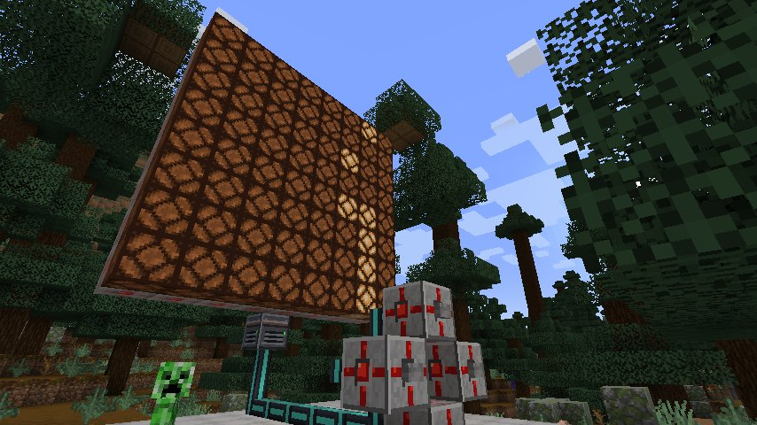
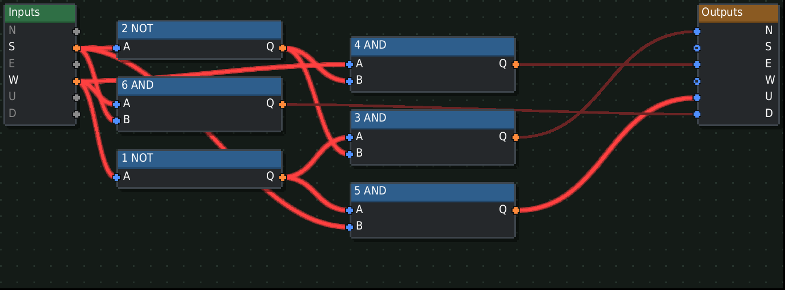
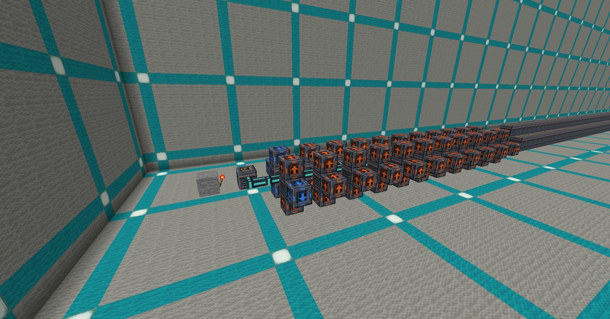
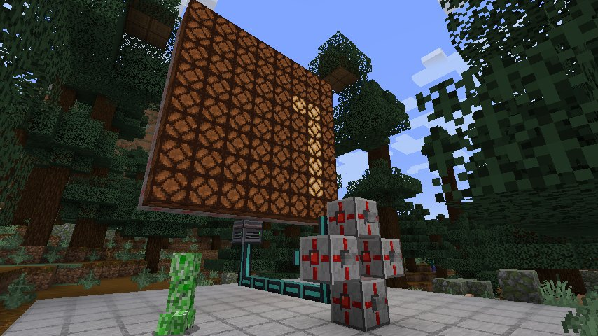

# Yog VLSI

**Design redstone circuits, print them onto microchips and build computers out of them**

**English** · [Русский](README.ru.md)

[How it works](#-how-it-works) · [Ready-made circuits](#-ready-made-circuits) · [YOG-8](#-yog-8-a-computer-on-one-chip) · [Tiers](#-tiers) · [Install](#-install) · [Contributing](CONTRIBUTING.md)

---

Yog VLSI (Very Large Scale Integration) turns redstone circuits into items.
Build a circuit in a private editing world, print it onto a chip at the VLSI
Workbench, and put chips into an ALU block. There they run in a fast native
redstone simulator — far faster than the world itself — and talk to the world
through ports and cables. Chips can hold other chips, so a whole computer
fits into one block.

## 🔧 How it works

**1. Design.** Put a blank chip into the VLSI Workbench and press Design. You
are taken into a flat, private world sized by the chip's tier. Build any
redstone you like and mark its inputs and outputs with ports. Leaving saves
the design.

**2. Fabricate.** Press Fabricate to print the design onto the chip. It costs
resources from the workbench's store — about a quarter of what the blocks
themselves would cost. A design can also be saved onto a Blueprint to share
or to print again.

**3. Wire up.** Put chips into an ALU. Its screen is a board: chips are nodes,
the ALU's six faces are inputs and outputs, and you drag wires between them.
Every face can also carry a digital bus with dozens of channels.

**4. Connect to the world.** Redstone Ports turn redstone into a channel of
a digital cable and back — lamps, buttons, doors, anything. Name a port and
pick its channel, and it shows up on the ALU's board under that name.

### The simulator

The circuit inside a chip follows vanilla's rules: dust and its power levels,
torches, repeaters, comparators reading containers, observers, pistons with
slime and honey, hoppers and droppers. A chip whose logic is pure is also
compiled into a lookup table in the background, so a chip of chips costs
almost nothing to run. All ALUs in a world share a fixed time budget per
tick, so even a large machine can't slow the server down.

## 📚 Ready-made circuits

An empty Blueprint can be written with one of the built-in designs, so you
don't have to build the basics by hand:

| Gates | Memory | Arithmetic and routing |
|---|---|---|
| NOT, AND, OR, NAND, NOR, XOR, XNOR | RS latch, D latch, D flip-flop, T flip-flop, register bit, memory bit | half adder, full adder, multiplexer, demultiplexer, 2-to-4 decoder |

Each is a real redstone circuit with a test of its truth table. Designs are
plain text files — see [src/designs](src/designs/README.md) to add your own.

## 🖥 YOG-8: a computer on one chip

YOG-8 is an 8-bit computer of about 2,500 gates — VLSI chips on 334
netherite ALUs, all inside a single chip: a program ROM, 32 bytes of
RAM, an accumulator, an index register, a random number generator, an 8×8
screen and four buttons. It plays Snake.

The computer is generated from a description of its gates: an assembler, an
emulator to check programs, a gate-level simulator and a generator that lays
the gates out into ALUs. Everything is in [tools/pc](tools/pc/README.md).

## 📊 Tiers

| Tier | Steps per tick | Editing world | Chips in an ALU | Bus channels per face |
|---|---:|---|---:|---:|
| Wood | 8 | 16 × 16 × 16 | 2 | 8 |
| Stone | 32 | 32 × 32 × 32 | 3 | 16 |
| Gold | 128 | 64 × 64 × 64 | 4 | 24 |
| Iron | 512 | 64 × 64 × 64 | 5 | 32 |
| Diamond | 4096 | 128 × 128 × 128 | 6 | 48 |
| Netherite | 32768 | 256 × 256 × 256 | 8 | 64 |

A step is one redstone tick of the circuit inside the chip; the world does one
per game tick. Tiers, resources and costs are data tables in [content](content)
that a modpack can change.

## 📦 Install

1. Install the [Yog loader](https://github.com/F000NKKK/Yog-Mod-Loader) for
   Fabric, Forge or NeoForge (Minecraft 1.20.1, 1.21.1 or 26.2).
2. Put yog-vlsi.yog into the yog-mods folder of your game directory.

To build it yourself, run `yog build` in this folder; the package appears in
bin/. The mod is edited in [Yog IDLE](https://github.com/F000NKKK/Yog-IDLE),
which shows its screens, blocks, recipes and tables visually.

## 🤝 Contributing

Ideas, bug reports and pull requests are welcome — see
[CONTRIBUTING.md](CONTRIBUTING.md). The full design (in Russian) is in
[DESIGN.md](DESIGN.md).

## 📄 License

[AGPL-3.0](LICENSE).

Part of the [Yog](https://github.com/F000NKKK/Yog-Mod-Loader) project · [Back to top](#top)

