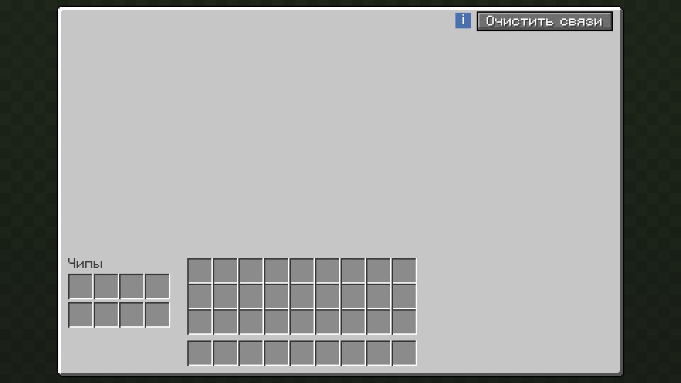
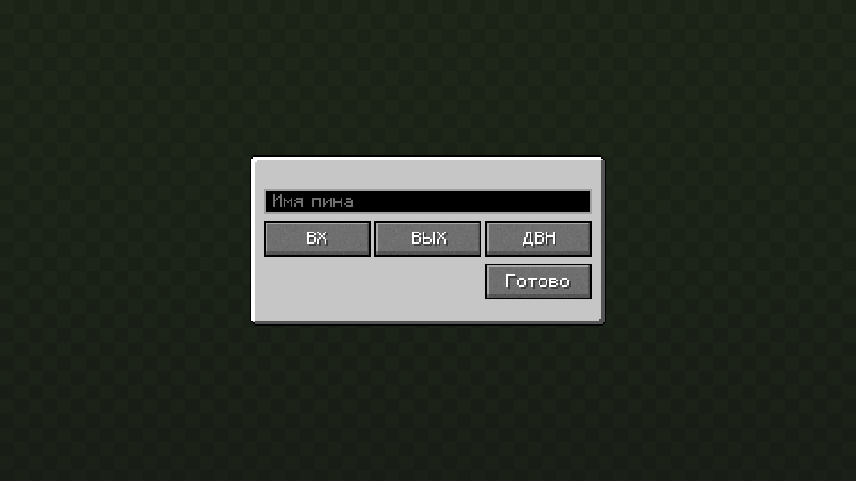

<div align="center">

<a id="top"></a>

# 🔲 Yog VLSI

### Проектирование, производство и установка редстоун-микросхем с симуляцией на Rust

[](https://github.com/F000NKKK/Yog-Mod-Loader)
[](LICENSE)
[](yog.toml)
[](https://crates.io/crates/yog-api)


🇺🇸 [English](README.md) | 🇷🇺 **Русский**

[Обзор](#-обзор) • [Возможности](#-возможности) • [Экраны](#-экраны) • [Тиры чипов](#-тиры-чипов) • [Сборка](#-сборка) • [Статус](#-статус)

</div>

---

## 📖 Обзор

**Yog VLSI** (*Very Large Scale Integration*) превращает редстоун-схемы в
предметы. Вы проектируете схему в личном мире-редакторе, печатаете её на
микросхему в верстаке СБИС и ставите чипы в блок АЛУ. Там они работают в
нативной виртуальной машине редстоуна на Rust, до двух раз быстрее ванильной,
и общаются с миром через именованные редстоун-порты.

Мод работает на [Yog Mod Loader](https://github.com/F000NKKK/Yog-Mod-Loader):
один файл `.yog` для Fabric, Forge и NeoForge, Minecraft 1.20.1 и 1.21.1.

## 🌟 Возможности

### 🛠️ Верстак СБИС

- **Библиотека чертежей у каждого игрока**: чертежи хранятся на сервере и
  доступны с любого верстака.
- **Мир-редактор**: откройте чертёж, и вы окажетесь в плоском личном
  измерении, размер которого зависит от тира чипа. Стройте любой редстоун;
  поле очищается при сохранении или выходе, и в нём никто не остаётся.
- **Порты**: ставьте блоки `yog-vlsi:port` в любом месте схемы и давайте им
  имена; порт бывает входом, выходом или и тем и другим.
- **Производство**: печать чипа тратит ресурсы из пополняемого хранилища
  верстака — примерно четверть того, что стоили бы сами блоки.

### 🔌 АЛУ

- **Чипы в слотах**: АЛУ держит несколько чипов и исполняет их каждый тик.
- **Граф узлов**: соединяйте выходной порт одного чипа со входом другого
  прямо на экране АЛУ — граф рисуется и редактируется там же.
- **Именованные редстоун-порты** на сторонах АЛУ связывают граф с миром.

### ⚡ Виртуальная машина редстоуна

- **Ванильные правила**: формы и уровни сигнала пыли, факелы, повторители,
  компараторы (в том числе чтение контейнеров), наблюдатели, поршни со
  слизью и мёдом, воронки, выбрасыватели и контейнеры работают как в игре.
- **Быстро**: форма каждого провода считается один раз за шаг; полный слой
  Netherite-чипа делает шаг примерно за 6 мс (`cargo bench`).

## 🖼️ Экраны

Нарисованы дизайнером экранов [Yog-IDLE](https://github.com/F000NKKK/Yog-IDLE)
шрифтом и текстурами игры — тем же кодом yog-ui, что работает в игре.

<div align="center">

| | |
|:---:|:---:|
|  |  |
| Верстак: чип, ресурсы, чертёж и стоимость | АЛУ: граф узлов, слоты чипов, инвентарь |
|  | |
| Порт: имя и направление | |

</div>

## 📊 Тиры чипов

| Тир | Тиков/с | Мир-редактор | Относительно ванили |
|---|---:|---|---:|
| Дерево | 5 | 16×16×16 | 0,25× |
| Камень | 10 | 32×32×32 | 0,5× |
| Золото | 20 | 64×64×64 | 1× |
| Железо | 25 | 64×64×64 | 1,25× |
| Алмаз | 30 | 128×128×128 | 1,5× |
| Незерит | 40 | 256×256×256 | 2× |

## 🔨 Сборка

```bash
yog build                           # все платформы
YOG_TARGETS=linux-x86_64 yog build  # одна платформа, быстрее
```

Получится `artifacts/yog-vlsi.yog` — положите его в `<папка игры>/yog-mods/`,
а jar загрузчика Yog — в `mods/`.

## 🚧 Статус

Играбельно, активно разрабатывается. Дальше: цифровые каналы (шины) между
АЛУ и чертежи-предметы для обмена схемами. Полный дизайн — в
[DESIGN.md](DESIGN.md).

## 📄 Лицензия

AGPL-3.0-only — см. [LICENSE](LICENSE).

<div align="center">

[⬆ Наверх](#top)

</div>
