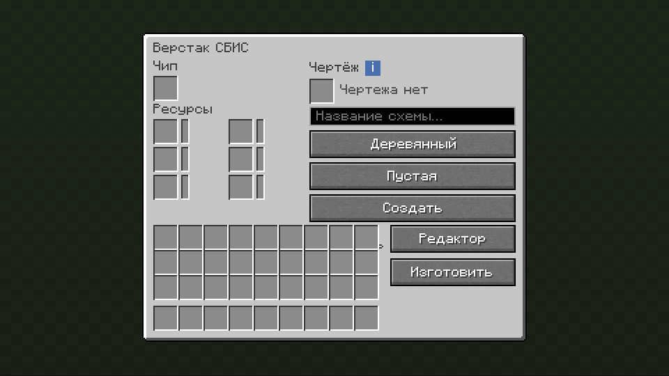
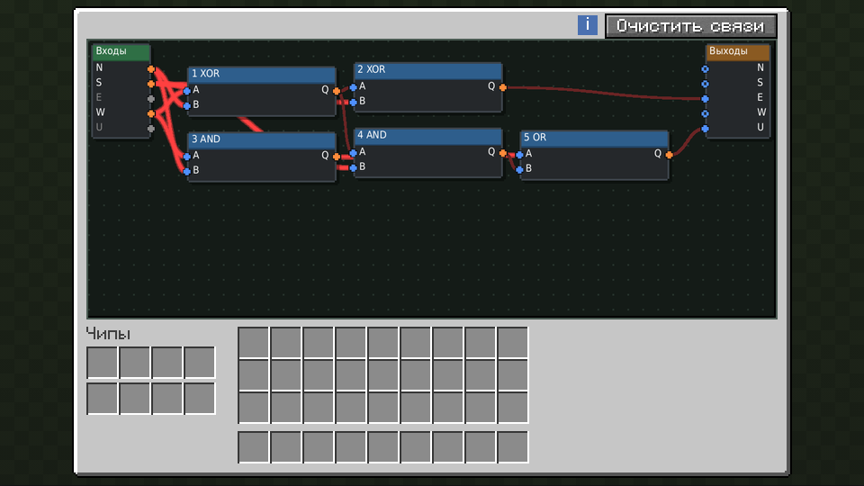
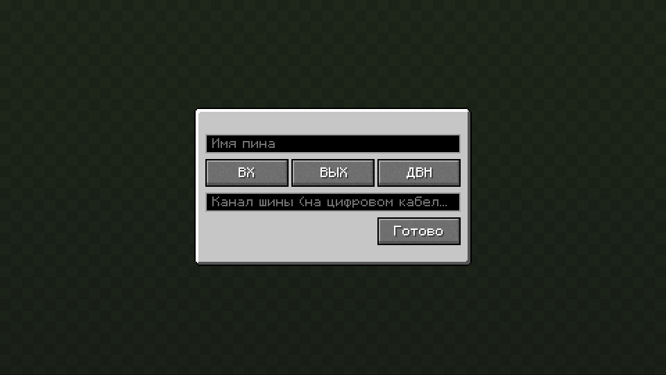
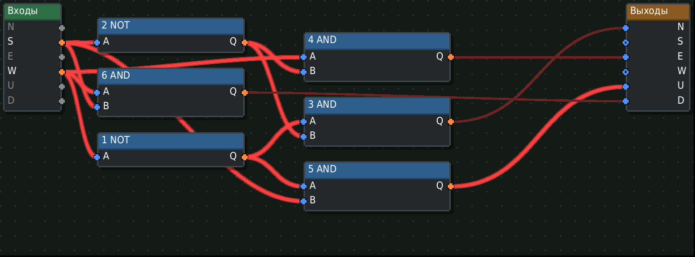

# Yog VLSI

**Проектируйте редстоун-схемы, печатайте их на микрочипы и собирайте из них компьютеры**

[English](README.md) · **Русский**

[Как это работает](#-как-это-работает) · [Готовые схемы](#-готовые-схемы) · [YOG-8](#-yog-8-компьютер-на-одном-чипе) · [Уровни](#-уровни) · [Установка](#-установка) · [Участие](CONTRIBUTING.md)

---

Yog VLSI (Very Large Scale Integration, СБИС) превращает редстоун-схемы в
предметы. Постройте схему в отдельном мире-редакторе, напечатайте её на чип в
верстаке СБИС и вставьте чипы в блок АЛУ. Там они работают в быстром нативном
симуляторе редстоуна — гораздо быстрее, чем сам мир, — и общаются с миром
через порты и кабели. Чипы могут содержать другие чипы, так что целый
компьютер помещается в один блок.

## 🔧 Как это работает

**1. Проектирование.** Положите пустой чип в верстак СБИС и нажмите
«Редактор». Вы попадёте в плоский личный мир, размер которого зависит от
уровня чипа. Стройте любой редстоун и отмечайте входы и выходы портами. При
выходе схема сохраняется.

**2. Изготовление.** Кнопка «Изготовить» печатает схему на чип. Это стоит
ресурсов из запаса верстака — примерно четверть того, что стоили бы сами
блоки. Схему можно сохранить на чертёж, чтобы поделиться ею или напечатать
снова.

**3. Соединение.** Вставьте чипы в АЛУ. Его экран — это плата: чипы — узлы,
шесть граней АЛУ — входы и выходы, а провода между ними тянутся мышью. Каждая
грань может нести и цифровую шину с десятками каналов.

**4. Связь с миром.** Редстоун-порты переводят редстоун в канал цифрового
кабеля и обратно — лампы, кнопки, двери, что угодно. Дайте порту имя и
выберите канал, и он появится на плате АЛУ под этим именем.

### Симулятор

Схема внутри чипа подчиняется правилам ванильной игры: пыль и уровни сигнала,
факелы, повторители, компараторы с чтением контейнеров, наблюдатели, поршни со
слизью и мёдом, воронки и выбрасыватели. Чип с чистой логикой ещё и
компилируется в фоне в таблицу истинности, поэтому чип из чипов почти ничего
не стоит. Все АЛУ мира делят фиксированный бюджет времени на тик, так что даже
большая машина не замедлит сервер.

## 📚 Готовые схемы

На пустой чертёж можно записать одну из встроенных схем, чтобы не строить
основы вручную:

| Вентили | Память | Арифметика и коммутация |
|---|---|---|
| NOT, AND, OR, NAND, NOR, XOR, XNOR | RS-защёлка, D-защёлка, D-триггер, T-триггер, бит регистра, бит памяти | полусумматор, полный сумматор, мультиплексор, демультиплексор, дешифратор 2→4 |

Каждая — настоящая редстоун-схема с тестом таблицы истинности. Схемы — это
простые текстовые файлы, как добавить свою, описано в
[src/designs](src/designs/README.md).

## 🖥 YOG-8: компьютер на одном чипе

YOG-8 — 8-битный компьютер примерно из 2 500 вентилей: чипы СБИС на 334
незеритовых АЛУ, и всё это внутри одного чипа. В нём ПЗУ программы, 32 байта
ОЗУ, аккумулятор, индексный регистр, генератор случайных чисел, экран 8×8 и
четыре кнопки. Он играет в змейку.

Компьютер генерируется из описания его вентилей: ассемблер, эмулятор для
проверки программ, симулятор на уровне вентилей и генератор, раскладывающий
вентили по АЛУ. Всё это лежит в [tools/pc](tools/pc/README.md).

## 📊 Уровни

| Уровень | Шагов за тик | Мир-редактор | Чипов в АЛУ | Каналов шины на грань |
|---|---:|---|---:|---:|
| Дерево | 8 | 16 × 16 × 16 | 2 | 8 |
| Камень | 32 | 32 × 32 × 32 | 3 | 16 |
| Золото | 128 | 64 × 64 × 64 | 4 | 24 |
| Железо | 512 | 64 × 64 × 64 | 5 | 32 |
| Алмаз | 4096 | 128 × 128 × 128 | 6 | 48 |
| Незерит | 32768 | 256 × 256 × 256 | 8 | 64 |

Шаг — один редстоун-тик схемы внутри чипа; мир делает один такой за игровой
тик. Уровни, ресурсы и стоимости — таблицы данных в [content](content),
которые сборка модов может поменять.

## 📦 Установка

1. Установите [загрузчик Yog](https://github.com/F000NKKK/Yog-Mod-Loader) для
   Fabric, Forge или NeoForge.
2. Положите yog-vlsi.yog в папку yog-mods в папке игры.

Чтобы собрать мод самому, выполните `yog build` в этой папке — пакет появится
в bin/. Мод редактируется в [Yog IDLE](https://github.com/F000NKKK/Yog-IDLE),
где его экраны, блоки, рецепты и таблицы видны наглядно.

## 🤝 Участие

Идеи, сообщения об ошибках и pull request'ы приветствуются — см.
[CONTRIBUTING.md](CONTRIBUTING.md). Полное описание замысла —
в [DESIGN.md](DESIGN.md).

## 📄 Лицензия

[AGPL-3.0](LICENSE).

Часть проекта [Yog](https://github.com/F000NKKK/Yog-Mod-Loader) · [Наверх](#top)

